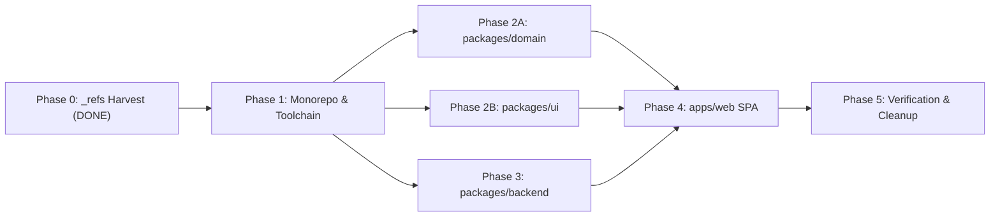

# Execution Plan — Vite+ Monorepo (Convex + TanStack + Mantine v9 + BlockNote + Zustand)

> **Execution Strategy:** Phase 0 (`_refs/`) is complete. Assemble a lean `pnpm@12.21.0` + `vite-plus@1.7.0` monorepo modeled on `_refs/cove-monorepo`, enforce strict Separation of Concerns (`AGENTS.md`), verify every phase via cached `vpr` tasks, then delete `_refs/`.

---

## Target Monorepo Layout

```text
.
├── apps/
│   └── web/                         # Pure Vite+ React 19 SPA (NO TanStack Start / SSR)
│       ├── src/
│       │   ├── app/                 # Providers (Mantine, Convex, QueryClient, Router, Devtools)
│       │   ├── data/                # Convex client, QueryClient, TanStack DB collections
│       │   ├── features/            # Vertical slices (records/, documents/, assets/, search/)
│       │   ├── routes/              # TanStack Router SPA file-based routes
│       │   ├── stores/              # Zustand client-only UI stores
│       │   └── main.tsx
│       ├── .env.schema              # Varlock schema (source of truth -> generates env.d.ts)
│       ├── .env.example
│       ├── .env.local               # Local secrets/URLs (gitignored)
│       ├── postcss.config.mjs       # Harvested from _refs/vite-template
│       ├── vite.config.ts           # Pure SPA Vite+ config (router-plugin + react + varlock + build cache)
│       └── package.json
├── packages/
│   ├── backend/                     # Convex 1.51 workspace (@repo/backend)
│   │   ├── convex/
│   │   │   ├── lib/                 # convex-helpers auth-ready wrappers, workpool, rag factory
│   │   │   ├── convex.config.ts     # Mounts rag + workpool ("ragIndexPool") + defineApp({ env })
│   │   │   ├── schema.ts            # records, documents, assets (clientId + indexes + searchIndex)
│   │   │   ├── records.ts
│   │   │   ├── documents.ts         # listSummaries (no body) + getBySlug + Workpool RAG enqueue
│   │   │   ├── assets.ts            # Native Convex Storage 3-step upload & cascade delete
│   │   │   ├── search.ts            # Keyword full-text search query
│   │   │   ├── searchActions.ts     # RAG indexDocument + semanticSearch actions
│   │   │   └── *.test.ts            # convex-test (@edge-runtime/vm) suites
│   │   ├── convex.json
│   │   └── package.json
│   ├── ui/                          # Mantine v9.8.2 + BlockNote 0.57 Design System (@repo/ui)
│   │   ├── src/
│   │   │   ├── styles/              # tokens.css (raw scales) + semantic.css (light/dark + --bn-colors-*)
│   │   │   ├── theme/               # theme.ts (createTheme + defaultProps), cssVariablesResolver.ts
│   │   │   ├── primitives/          # AppFrame, RecordTable, AssetDropzone/Gallery, MarkdownWorkspace (BlockNote)
│   │   │   └── index.ts
│   │   └── package.json
│   └── domain/                      # Pure TS + Zod v4 schemas, frontmatter/chunk helpers (@repo/domain)
├── tools/
│   └── tsconfig/                    # Shared TS 7.0.2 configs (@repo/tsconfig)
├── .agents/
│   ├── skills/                      # Convex AI skills, rag/workpool docs, TanStack Intent
│   └── workflow.md
├── docs/                            # Architecture & upgrade guides
├── plans/                           # Split phase execution specs
├── .fallowrc.jsonc                  # Dead-code & unused-export analyzer config
├── .stylelintignore
├── .stylelintrc.json                # Mechanical ban on raw hex/colors/units in *.module.css
├── .vite-hooks/                     # Vite+ staged commit hooks (vp fmt + stylelint)
├── AGENTS.md                        # Monorepo rules, Mantine MCP requirement, DAG & state ownership
├── PLAN.md                          # This master orchestrator
├── pnpm-workspace.yaml              # Catalog + vite override (NO minimumReleaseAge, NO vitest override)
├── vite.config.ts                   # Root Vite+ config (Oxlint, Oxfmt, Vitest projects, Vite Task cache)
└── package.json
```

---

## Phase Execution DAG & Parallelization



- **Phase 0 (`_refs/` audit — DONE):**
  - `_refs/cove-monorepo`: Keep root workspace structure, `tools/tsconfig`, `.vite-hooks`, `fallow`, `varlock`, `.agents/workflow.md`. Drop SSR packages (`auth`, `db`, `ui`, `logger`), Nitro, Drizzle, Tailwind, and TanStack Start.
  - `_refs/vite-template`: Harvest `oxc-config-mantine`, `postcss.config.mjs`, `.stylelintrc.json`, `vitest.setup.mjs`, `test-utils/`. Ignore Yarn files and old `resolutions`.
  - `_refs/paper-upper`: Canonical Vite+ `1.7.0` layout (`pnpm-workspace.yaml` catalog + `vite` override, `devEngines.packageManager`, TS `7.0.2` options, local docs in `node_modules/vite-plus/docs`).
  - `_refs/convex-ref`: Harvest `convex/tsconfig.json`, `convex/_generated/ai/guidelines.md`, and `.agents/skills/`. Do **not** copy its TS6 alias or auth example tables.
  - `_refs/tanstack-spa`: Created with `"routerOnly": false` (TanStack Start + Prisma + Paraglide). **Do NOT copy its `vite.config.ts` or `__root.tsx`** — Phase 4 writes clean pure-SPA router config directly.

---

## Phase Index & Orchestration Table

| Phase | Spec | Owned Paths | Depends On | Verification Gate |
| :--- | :--- | :--- | :--- | :--- |
| **Shared** | [plans/packages-and-versions.md](plans/packages-and-versions.md) | `pnpm-workspace.yaml` catalog | — | Exact npm versions & peer rules |
| **Phase 1** | [plans/phase-1-monorepo-toolchain.md](plans/phase-1-monorepo-toolchain.md) | Root configs, `tools/tsconfig/`, `.vite-hooks/`, `.agents/workflow.md`, `apps/web/.env.schema` | Phase 0 | `vp install`, `vpr env:codegen`, `vpr check` (x2 cache hit), `vpr stylelint`, `vpr fallow` |
| **Phase 2** | [plans/phase-2-ui-and-domain.md](plans/phase-2-ui-and-domain.md) | `packages/domain/**`, `packages/ui/**`, `apps/web/postcss.config.mjs` | Phase 1 *(2A, 2B & Phase 3 can run in parallel)* | Boundary grep, `vpr check`, `vpr stylelint`, `vpr test` |
| **Phase 3** | [plans/phase-3-convex-backend.md](plans/phase-3-convex-backend.md) | `packages/backend/**`, `.agents/skills/**` | Phase 1 *(parallel with Phase 2)* | `vpr convex:typecheck`, `vpr check`, `vpr test` |
| **Phase 4** | [plans/phase-4-web-app.md](plans/phase-4-web-app.md) | `apps/web/**` | Phases 2 & 3 | `vpr check`, `vpr stylelint`, `vpr test`, `vpr build`, `vpr fallow`, `vpr env:audit` |
| **Phase 5** | [plans/phase-5-verification-cleanup.md](plans/phase-5-verification-cleanup.md) | Full repo audit + `_refs/` removal | Phase 4 | Full pipeline x2 cache proof + 2-tab smoke test + `_refs/` removed |

---

## AI Orchestration Handoff Prompt Template

Use this prompt when assigning a single phase (or parallel wave) to a fresh agent session:

> Read `AGENTS.md`, `plans/packages-and-versions.md`, and ONLY your assigned phase plan (`plans/phase-<N>-*.md`). Do not read unrelated phases. Stay strictly within your phase's **Owned Paths**, check `mantine-mcp` before writing any UI component or hook, and follow `packages/backend/convex/_generated/ai/guidelines.md` before writing Convex code. Run every command in your phase's **Verification Gate**, confirm zero errors, stop at the gate, and report exact commands run and outputs observed.

---

## Architecture & Upgrade Reference Docs

- [docs/markdown-editor-options.md](docs/markdown-editor-options.md) — BlockNote v0.57 Mantine v9 setup, raw fallback, and `@convex-dev/prosemirror-sync` upgrade path
- [docs/storage-and-auth-options.md](docs/storage-and-auth-options.md) — Native Convex storage vs R2/Files Control/ConvexFS, single-user middleware vs Better Auth / Convex Auth v2 / Clerk
- [docs/convex-others.md](docs/convex-others.md) — Optional Convex Components roadmap beyond v1 (`rag` & `workpool`)
- [docs/other-refs.md](docs/other-refs.md) — Curated external reference templates and official Markdown docs
